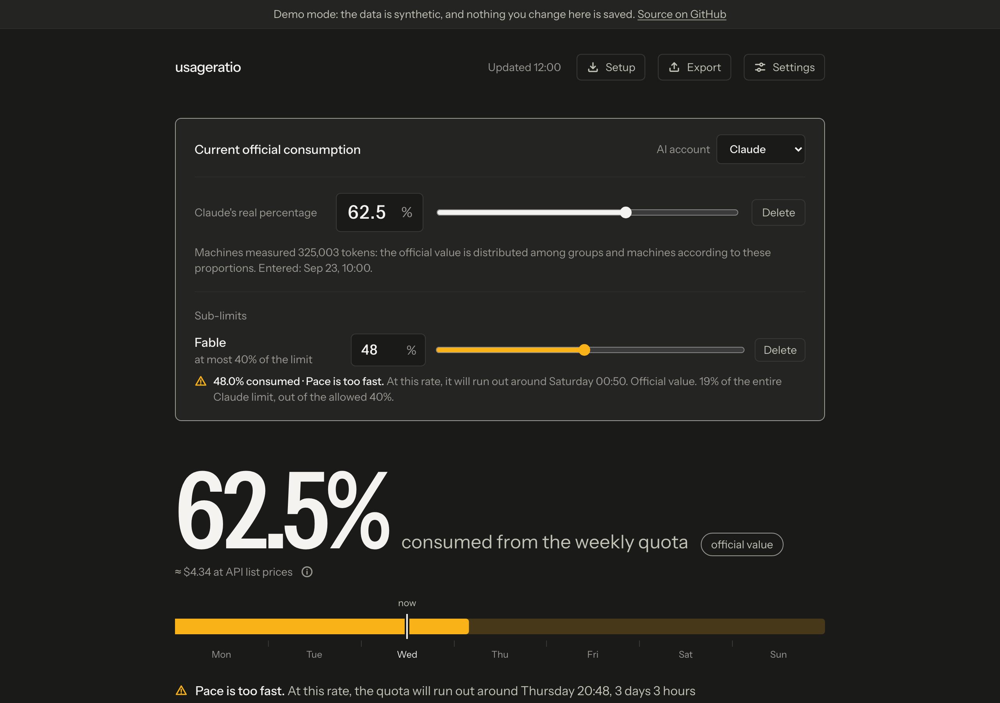
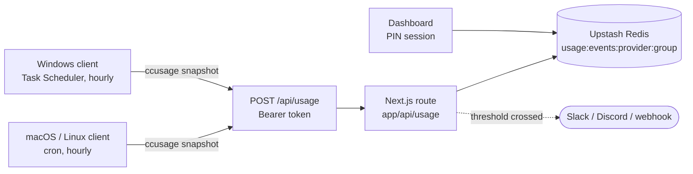
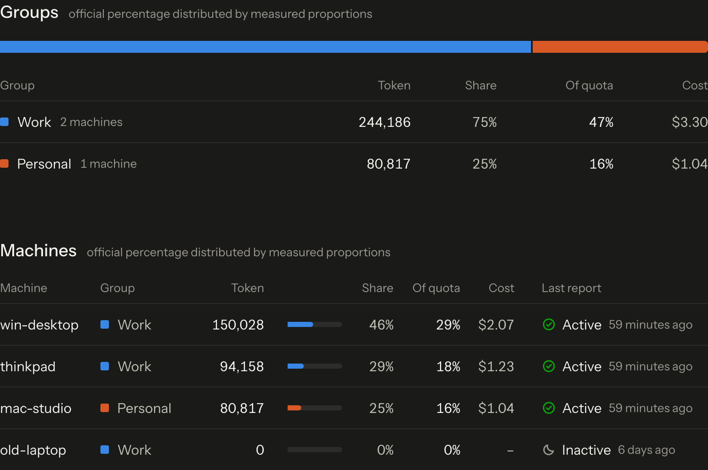
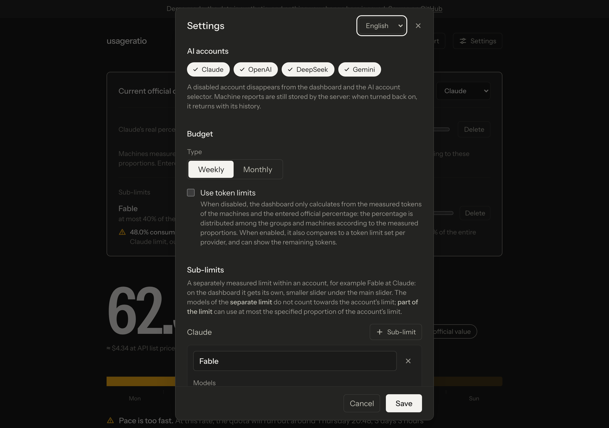
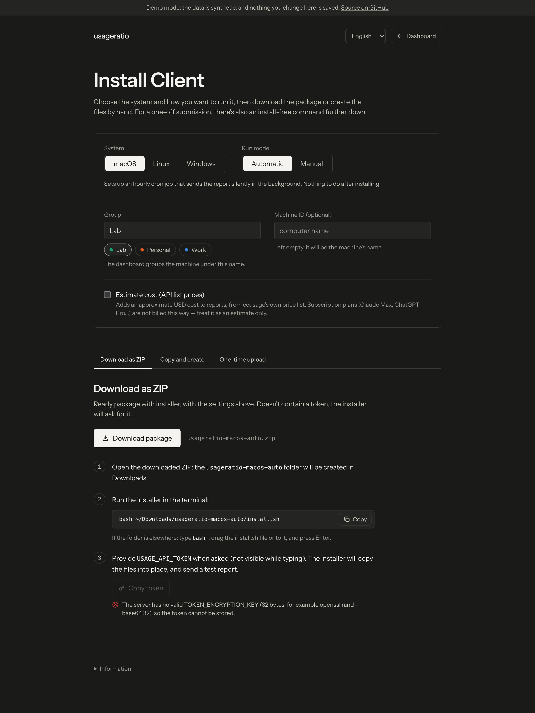
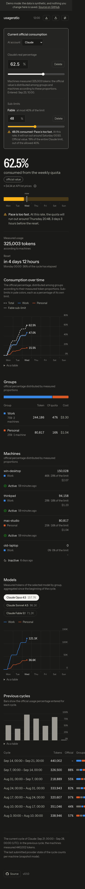

<p align="center">
  <picture>
    <source media="(prefers-color-scheme: dark)" srcset="docs/assets/logo-dark.svg">
    <source media="(prefers-color-scheme: light)" srcset="docs/assets/logo-light.svg">
    
  </picture>
</p>

<p align="center">
  One dashboard for the token budget every AI coding agent is quietly spending, on every machine you own.
</p>

<p align="center">
  <a href="https://github.com/snktibor/usageratio/actions/workflows/ci.yml"></a>
  <a href="https://github.com/snktibor/usageratio/actions/workflows/codeql.yml"></a>
  <a href="LICENSE"></a>
  <a href="https://github.com/snktibor/usageratio/releases"></a>
  <a href=".nvmrc"></a>
  <a href="CONTRIBUTING.md"></a>
</p>

<p align="center">
  <a href="docs/assets/dashboard-full.png">
    
  </a>
</p>

## What it is

usageratio is a self-hosted dashboard for AI coding-agent token budgets. A small client runs hourly
on every machine you use — a MacBook, a desktop, a work laptop — reads [`ccusage`](https://github.com/ryoppippi/ccusage)'s
local usage data (Claude Code, Codex/OpenAI, DeepSeek, Gemini, or anything else `ccusage` can parse),
and reports a snapshot to one Next.js app. A single PIN-protected dashboard then shows the weekly or
monthly burn per provider, per group, and per machine, with the provider's own official percentage
laid over the measured proportions.

The problem it solves: a subscription quota is shared across every machine that uses it, but each
provider's own dashboard only shows one number for the account — not which machine or which project
spent it. usageratio adds that missing dimension without asking any provider for an API it doesn't
have.

## Try it in 30 seconds

```bash
git clone https://github.com/snktibor/usageratio.git
cd usageratio
npm ci
npm run dev:demo
```

Open [`http://localhost:3000/en`](http://localhost:3000/en/) — a synthetic multi-machine, multi-provider
dataset, no Redis, no PIN, and every write is refused. Good enough to see the whole dashboard, the
charts, and the Setup page before deploying anything.

## How it works



Each machine's client sums `ccusage`'s local data for the current cycle and POSTs a snapshot once an
hour with a bearer token. The route validates and rate-limits it, then writes it to a Redis sorted
set keyed by provider and group (`lib/redis-keys.ts` documents the full layout). The dashboard reads
the same store behind a PIN session; a threshold alert fires a webhook the same way.

## Features

| | |
| --- | --- |
| **Multi-provider, multi-machine** | Claude, Codex/OpenAI, DeepSeek, Gemini, or any id `ccusage` produces, tracked per machine with a health state (active / late / inactive / manual). |
| **Groups with exclusions** | Machines are grouped (Work, Personal, …); a group can be excluded from counting toward specific accounts. |
| **Sub-limits** | A separately measured limit inside a provider (e.g. a model family within Claude), shown as its own slider under the account's. |
| **Official-percentage restatement** | Enter the provider's own official usage percentage; it's redistributed across groups and machines by their measured proportions. |
| **Burn-down and per-model charts** | Hand-written, keyboard-accessible SVG — no chart library — with an "as a table" fallback for every chart. |
| **Previous-cycles history** | A bar per past cycle, with the same official-percentage detail on hover. |
| **CSV / JSON export** | The current or a previous cycle's raw reports, filterable by provider. |
| **Threshold alerts** | A webhook per crossed percentage, formatted for Slack or Discord, or as plain JSON for anything else. |
| **Opt-in cost estimate** | An approximate USD figure from `ccusage`'s own API list prices — off by default, and never a substitute for a subscription's real billing. |
| **One-click client install** | A ready-to-run ZIP or copy-paste package for macOS, Linux, or Windows, plus an install-free one-shot command for a single report. |
| **Per-machine revocable tokens** | An alternative to the shared bearer token that can be issued and revoked per machine from the settings panel. |
| **Machine, group, and provider management** | Rename, recolor, re-group, or remove any of them from the dashboard, without touching a client. |
| **PIN or passphrase login** | 5–64 characters, constant-time comparison, escalating lockout on repeated failures, and sudo re-confirmation before revealing a stored secret. |
| **Nonce CSP and security headers** | A strict, nonce-based Content-Security-Policy plus COOP, CORP, and HSTS, set for every request. |
| **Encrypted API-token vault** | The copy of the ingest token kept for the Setup page's *Copy token* button is AES-256-GCM sealed, with a full reveal/rotate audit trail. |
| **EN / HU / DE** | Full locale parity — every key, every ICU placeholder — is enforced by a test. |
| **Demo mode** | The whole app on an in-memory store with a synthetic dataset — no Redis, no PIN, read-only. |
| **Vercel + Upstash, or Docker** | Deploy to Vercel's free tier, or self-host the same image anywhere with Docker Compose. |

<table>
<tr>
<td width="400">
<a href="docs/assets/groups-machines.png"></a>
<br><sub>Groups and machines, with per-row cost and health.</sub>
</td>
<td width="400">
<a href="docs/assets/settings.png"></a>
<br><sub>Settings: accounts, budget type, and sub-limits.</sub>
</td>
</tr>
<tr>
<td width="400">
<a href="docs/assets/setup.png"></a>
<br><sub>Setup: pick a system and mode, install a client.</sub>
</td>
<td width="400">
<a href="docs/assets/mobile.png"></a>
<br><sub>The full dashboard, responsive down to a phone.</sub>
</td>
</tr>
</table>

## Quick start

**Deploy to Vercel:**

[](https://vercel.com/new/clone?repository-url=https%3A%2F%2Fgithub.com%2Fsnktibor%2Fusageratio&env=USAGE_API_TOKEN%2CDASHBOARD_PIN&envDescription=Required%20secrets%3A%20generate%20with%20openssl%2C%20see%20docs%2Fgetting-started.md&envLink=https%3A%2F%2Fgithub.com%2Fsnktibor%2Fusageratio%2Fblob%2Fmain%2Fdocs%2Fgetting-started.md&project-name=usageratio&repository-name=usageratio&stores=%5B%7B%22type%22%3A%22integration%22%2C%22protocol%22%3A%22storage%22%2C%22productSlug%22%3A%22upstash-kv%22%2C%22integrationSlug%22%3A%22upstash%22%7D%5D)

This clones the repo into your own account, prompts for `USAGE_API_TOKEN` and `DASHBOARD_PIN`, and
provisions an Upstash Redis database through the Vercel Marketplace alongside it. If the button ever
skips that step (integration availability can change), add **Upstash Redis** from the Vercel
Marketplace to the project yourself before the first deploy.

Then sign in with the PIN, open **Setup**, and install a client — see
[**Getting started**](docs/getting-started.md) for the full walkthrough, including the domain and
Redis-region notes.

Prefer to run it yourself? [**Docker self-hosting**](docs/self-hosting.md) covers the same app behind
`docker compose up -d`, with an optional bundled Caddy profile for HTTPS.

## Installing a client

Every machine that should report needs one of these. All routes end up running the same
`clients/shared/` reporting core; only how it's scheduled differs. Full details, flags, and exit
codes: [**docs/clients.md**](docs/clients.md).

| System | Automatic | Manual | One-shot | Uninstall |
| --- | --- | --- | --- | --- |
| **macOS** | Hourly `cron` job, silent | A `sync-tokens` shell alias | One install-free command, sends one report, leaves nothing behind | Remove the `crontab` entry, delete `~/.usageratio` |
| **Linux** | Hourly `cron` job, silent | A `sync-tokens` shell alias | Same one-shot command | Same as macOS |
| **Windows** | Hourly Task Scheduler task, silent | A desktop "Sync tokens" shortcut | One install-free PowerShell command | `install-task.ps1 -Uninstall`, delete `%USERPROFILE%\.usageratio` |

Every route is available from the dashboard's **Setup** page (ZIP download or copy-paste blocks), or
package-free from the command line.

## Configuration

The variables that matter to get running; everything else is documented inline in
[`.env.example`](.env.example) and in full at [**docs/configuration.md**](docs/configuration.md).

| Variable | Required | Purpose |
| --- | --- | --- |
| `USAGE_API_TOKEN` | Yes | Bearer token the clients authenticate with (`openssl rand -hex 32`). |
| `DASHBOARD_PIN` | Yes | The dashboard's PIN or passphrase, 5–64 characters. |
| `KV_REST_API_URL` / `KV_REST_API_TOKEN` | Yes | Upstash Redis REST credentials — injected automatically on Vercel. |
| `TOKEN_ENCRYPTION_KEY` | Optional | AES-256-GCM key so the Setup page can store and copy the API token (`openssl rand -base64 32`). |
| `CRON_SECRET` | Optional | Bearer token for `GET /api/cron/housekeeping`; required for the daily cleanup to run at all. |

## Security

Login is a constant-time PIN/passphrase check with escalating per-IP lockout, sudo re-confirmation
before any secret is revealed, and rolling sessions revoked instantly on logout or PIN change.
Clients authenticate with a constant-time-compared bearer token or an individually revocable
per-machine token. Every response carries a nonce-based CSP with no inline scripts, plus COOP, CORP,
and HSTS. The stored copy of the API token is AES-256-GCM encrypted with key-rotation support, and
every store, update, or reveal of it is written to an audit trail. See
[**SECURITY.md**](SECURITY.md) for the reporting process and [**docs/security.md**](docs/security.md)
for the full threat model, including its known limitations.

## Development

```bash
npm ci
npm run check              # Biome + tsc --noEmit + Vitest (1,015 tests across 64 files)
npm run coverage            # Vitest with coverage
npm run build && npm run e2e   # Playwright, against production builds (demo + real modes)
```

The bash/PowerShell clients have their own suites, run in CI but not by `npm run check`: `shellcheck`
and `bash -n` over `clients/**/*.sh`, and `Invoke-ScriptAnalyzer` plus a Pester suite
(`clients/tests`) over the PowerShell scripts. See [**CONTRIBUTING.md**](CONTRIBUTING.md) for
prerequisites and the full walkthrough, and
[**docs/demo-and-development.md**](docs/demo-and-development.md) for demo mode, seeding a local
store, and the screenshot suite.

## Documentation

- [**docs/README.md**](docs/README.md) — documentation index
- [Getting started](docs/getting-started.md) — deploying and installing the first client
- [Clients](docs/clients.md) — every install route, flags, and exit codes
- [Configuration](docs/configuration.md) — every environment variable
- [API](docs/api.md) — the ingest and dashboard endpoints
- [Data model](docs/data-model.md) — the Redis key layout
- [Security](docs/security.md) — the full threat model
- [Architecture](docs/architecture.md) — how the pieces fit together
- [Demo and development](docs/demo-and-development.md) — running and testing locally
- [Upgrading](docs/upgrading.md) — moving between versions
- [Self-hosting](docs/self-hosting.md) — running usageratio with Docker instead of Vercel

## Roadmap

- More agents beyond what `ccusage` recognizes out of the box (adding one is three small, tested
  steps — see [CONTRIBUTING.md](CONTRIBUTING.md)).
- A light theme; the dashboard is dark-only today.
- Per-user accounts — today's PIN/passphrase is one shared secret for the whole dashboard.
- More locales beyond EN/HU/DE.

## Acknowledgements

- [**ccusage**](https://github.com/ryoppippi/ccusage) — the local usage data every client reads.
- [**Upstash**](https://upstash.com) — the Redis REST API usageratio is built around.
- [**Vercel**](https://vercel.com) — the reference deployment target.
- [**next-intl**](https://next-intl.dev) — the i18n library behind EN/HU/DE.
- **Instrument Sans** — the UI typeface, licensed under the [SIL Open Font License](assets/fonts/OFL.txt).

## License

Licensed under the GNU General Public License, version 3 or (at your option) any later version.
Copyright (C) 2026 Tibor Sinka. See [LICENSE](LICENSE) for the full text.
